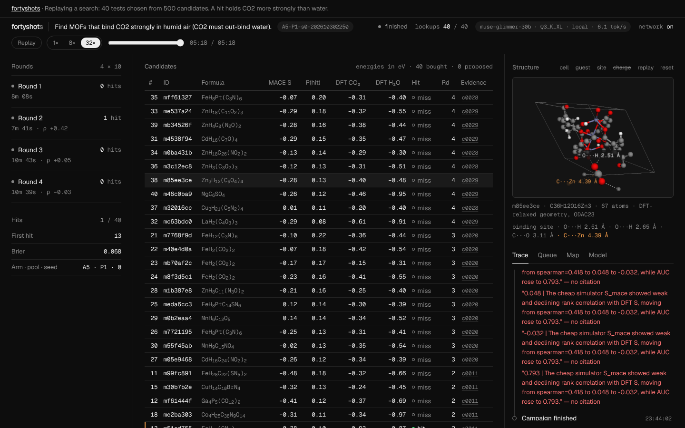

# fortyshots

**An AI scientist for materials discovery. It decides which experiments to run, learns from each result, and shows its work.**

     

**[Live site: watch a real campaign](https://print-EddyMa.github.io/fortyshots/)** · **[Demo video (3:00)]({{VIDEO_URL}})** · [Results](https://print-EddyMa.github.io/fortyshots/#/results) · [Pre-registration](PREREG.md)

> The AI decides what to test. Physics decides what's true. Every number it writes is checked.


*A real campaign on a test set: Muse Glimmer 30B picks ten materials per round with a stated confidence, critiques them by looking at the structures, and buys accurate simulations (DFT) one batch at a time.*

**3-minute demo:** goal → plan → pick 10 with confidence → critique with vision → you approve → 10 simulations → learn → ×4 → cited report → proposed new materials

> **Scope.** A research prototype, scored against existing DFT reference data. Its picks are among known materials, not new discoveries, and the materials it proposes are unvalidated. Every limitation is listed [below](#limitations).

**Check every number with no model, no keys and no account:**

```bash
git clone https://github.com/print-EddyMa/fortyshots && cd fortyshots && ./lab verify
```

Built Oct 27 – Nov 4, 2026 for the Meta Global AI Developer Hackathon. To run the agent itself on a Mac, see [MAC_SETUP.md](MAC_SETUP.md).

---

## Results

Status: **final** (filled from `results/results.json`; `./lab verify` recomputes it). Pre-registration: tag `prereg-v1`, sha256 `f5b216f38f4bd362fc93deb3f6a48d73e89a35fd7c40701e230299ba45c33638`.

Headline (the rule in PREREG §9 decides its wording; it always names both baselines):
> The Glimmer agent (A5) picked 1.40 hits in 40 lookups (95% CI 1.00–1.80) against 1.13 for random and 2.20 for the strongest baseline, greedy on the cheap simulator (MACE-greedy): it ties random, loses to MACE-greedy (difference -0.80, p = 1.000) and ties the random forest (RF-UCB, 1.39).

| Arm | What it is | Runs | Hits in 40 (mean, 95% CI) | Enrichment | Lookups per hit |
|---|---|---|---|---|---|
| A0 | Random | 250 | 1.13 [0.95, 1.32] | 1.01× | 35.3 |
| A1 | Pore and open-metal-site heuristic | 250 | 1.00 [0.00, 2.20] | 0.89× | 40.0 |
| A2 | Greedy on the cheap simulator (MACE) | 250 | 2.20 [2.00, 2.60] | 2.01× | 18.2 |
| A3 | Random-forest active learner (RF-UCB) | 250 | 1.39 [1.17, 1.62] | 1.25× | 28.8 |
| A4 | Glimmer, zero-shot (orders 40 at once) | 5 | 1.40 [1.00, 1.80] | 1.23× | 28.6 |
| **A5** | **Glimmer agent, 4 rounds of 10** | 5 | 1.40 [1.00, 1.80] | 1.27× | 28.6 |
| A6 | A5 without the random-forest tool | not recorded in time ([DEVIATIONS.md](DEVIATIONS.md) #1) | | | |

- Primary test, A5 vs A2, the strongest baseline (pool-stratified permutation, one-sided): difference -0.80, p = 1.000.
- A5 vs A3 (random forest): difference +0.01, p = 0.527.
- Ceilings at 40 lookups: a perfect oracle finds 14.00 per pool on average; random expects 1.12 (40 × hits ÷ 500).
- Calibration of the agent's P(hit): Brier 0.087 over 200 picks. Critic's visual reading of its own parity plot vs the computed Spearman: mean absolute error 0.24.
- Claim checker: 224 of 241 numeric claims in agent reports verified, 17 flagged.
- Leak probe (Glimmer ranks raw CSD refcodes with nothing else): AUC 0.65, at the upper edge of the range chance gives (0.35–0.65), so slight recall of known materials cannot be ruled out. Ranking from composition and descriptors alone (L2): AUC 0.39, at chance.
- Physics honesty panel (never shown to the agent): MACE hit AUC 0.49 [0.41, 0.56]; DFT at the starting geometry 0.65.

With 5 agent runs the intervals are wide, and we say so. Every number above links to its computation on the [results page](https://print-EddyMa.github.io/fortyshots/#/results).

## How it works

```
Mac (M4, 24 GB, Wi-Fi optional)
  llama-server 127.0.0.1:8080  <-  Muse Glimmer 30B GGUF + vision projector, --jinja
  fortyshots agent             ->  tools over committed caches: query_pool, get_descriptors, cheap_score,
                                   fit_surrogate, calibrate_oracle, render_structure, request_dft (40 max)
  runs/<id>/events.jsonl       ->  append-only ledger; replayed by the static site
```

Each campaign has 4 rounds. In each round the director explores the pool with tools, the proposer commits to 10 picks with a probability of being a hit, the critic looks at a rendered parity plot and a binding-site image and may veto up to 3 picks, and then the agent buys the 10 DFT results. From round 2 the agent must call `calibrate_oracle`, which compares the cheap simulator with the labels it has bought so far. It is not told how good the simulator is; what it does with the answer is its own decision. After round 4 the reporter writes a report with citations, and a deterministic claim checker verifies every number in it against the ledger.

### Where Muse Glimmer is used

| Role | Glimmer feature | What it produces | Fallback if it fails |
|---|---|---|---|
| Director | Native tool calls (parallel), `reasoning_strength: medium` | Tool calls that explore the pool and fit the surrogate | json_schema action mode, dispatched by our code |
| Proposer | json_schema output (grammar-enforced) | 10 picks with P(hit), rationale and cited evidence | Validate and retry twice, then the director's ranking (logged) |
| Critic | Vision through the `mmproj` projector | `visual_rho` (a numeric reading of the parity plot) and up to 3 vetoes | Text parity table (logged) |
| Reporter | Prose with `[call_id]` citations, `reasoning_strength: low` | Campaign report; text written by the model is labelled "written by Muse Glimmer 30B" | Template report from the ledger |
| Chemist (optional) | json_schema | Mutation specs for new candidates, marked "unvalidated · ML only" | Skipped |

One model file serves every role. Reasoning cannot be switched off in Glimmer; it arrives in `reasoning_content`, is capped with `--reasoning-budget`, and is shown collapsed in the console.

### Other Meta assets

- **ODAC23** (Meta FAIR, CC-BY-4.0): the hidden DFT labels and the DFT-relaxed CO2 poses shown in the 3D viewer.
- **EquiformerV2 ODAC checkpoint** (Meta FAIR): a cross-check for prospective mutants only. It was trained on ODAC23, so it is never a benchmark arm. It is downloaded at run time and never committed.

## Hardware and quantization

| | Value |
|---|---|
| Machine | MacBook Pro, Apple M4, 24 GB unified memory, macOS 26.5.2 |
| Model file | unsloth `Muse-Glimmer-30B-UD-Q3_K_XL.gguf` (13.36 GB) + Meta's `mmproj-Muse-Glimmer-30B-Q4_K_M.gguf` vision encoder (1.40 GB) + Meta's DFlash drafter `dflash-Muse-Glimmer-30B-Q4_K_M.gguf` (1.63 GB) |
| sha256 (published by Hugging Face, checked by `./lab download` and recorded in every run header) | `820d18e00c59376331eba62dd716a6bcdcaa305c2316f5da3a2fab36c7c37e15` (model) |
| llama.cpp | build b11960-8642541b2 (Homebrew), flags in [mac/profiles.json](mac/profiles.json) |
| Context | 32,768 tokens, 1 slot |
| GPU memory limit | `sudo sysctl iogpu.wired_limit_mb=20480` (resets on reboot) |
| Decode speed | 6.3 tok/s (median over agent calls) |
| Prompt speed | 32 tok/s |
| Memory while recording | 22.3 GB used, swap growth 3.6 GB |
| Minutes per A5 campaign | 52 (median) |
| DFlash drafter A/B | 3.0 → 6.8 tok/s with Meta's DFlash drafter, 68% of drafted tokens accepted |
| Live-demo profile | the same files with a 16K context |

**Why this build.** `./lab bench` on this Mac (Oct 29, a ~2K-token agent prompt, `doctor/*-bench-*.json` on branch `runs-mac`):

| Profile | Decode | Cold prefill |
|---|---|---|
| Meta Q4_K_M + vision | 3.9 tok/s | 35 tok/s |
| UD-Q3_K_XL + vision | 3.0 tok/s | 34 tok/s |
| **UD-Q3_K_XL + vision + DFlash** | **6.8 tok/s** (68% of drafted tokens accepted) | 33 tok/s |
| Meta Q4_K_M + DFlash, no vision | 7.0 tok/s (74% accepted) | 34 tok/s |

A base M4 has about 120 GB/s of memory bandwidth, so decode is bandwidth-bound; Meta's DFlash drafter more than doubles it. Q4_K_M with vision and the drafter (19.8 GB) does not fit next to macOS in 24 GB, so the recorded campaigns use the 3-bit build, which keeps vision at the drafter's speed.

## What changed since the application

We pitched a Llama agent driving Meta's UMA potential. UMA, ODAC25 and the Muse API need gated access or signups, and we committed to zero signups. So fortyshots runs on Meta's open-weights Muse Glimmer 30B and on Meta FAIR's openly downloadable ODAC23 data and EquiformerV2 checkpoint. We also measured, before building, that machine-learned potentials miss chemisorption at ODAC's starting geometries: MACE-MP-0 single points give a hit AUC of 0.49 [0.40–0.58] on 200 training MOFs (`research/out/fast_strat_mace.jsonl`), no better than chance. So the agent treats physics as noisy evidence and spends a DFT budget to decide, instead of trusting a simulator.

## Built during the hackathon

The repository's first commit is tagged `hackathon-start` (Oct 29, 2026); there is no earlier history. `git log --date=short --format='%h %ad %s' -- <path>` lists the commits for any row.

| Component | Path | Built here | Commit range |
|---|---|---|---|
| ODAC23 extraction, hashed IDs, pools, labels | `physics/`, `data/` | yes | `hackathon-start`..c43f1f7 |
| Research measurements behind the design (MACE, eqV2, Orb on ODAC configs) | `research/` | yes, Oct 29 | `hackathon-start` |
| MACE cheap-oracle cache | `physics/`, `data/mace_cache.parquet` | yes | `hackathon-start`..c43f1f7 |
| Agent: roles, tools, ledger, cassettes, claim checker, mock server, live server | `fortyshots/` | yes | `hackathon-start`..c43f1f7 |
| Baselines, statistics, `verify` | `bench/` | yes | `hackathon-start`..c43f1f7 |
| Web console, results, gallery | `web/` → `docs/` | yes | `hackathon-start`..c43f1f7 |
| Mac runtime | `lab`, `mac/` | yes | `hackathon-start`..c43f1f7 |
| Recorded campaigns | `runs/` | yes, recorded Oct 30 – Nov 2 on the Mac | d6b475d..c43f1f7 |
| Muse Glimmer weights, llama.cpp, ODAC23, MACE-MP-0, EquiformerV2, CoRE MOF, fonts and JS libraries | — | no, reused; see [PRIOR_WORK.md](PRIOR_WORK.md) | — |

## Reproduce

**Every published number, no model, any OS** (about a minute):
```bash
git clone https://github.com/print-EddyMa/fortyshots && cd fortyshots
uv sync
./lab verify
```
`./lab verify` runs `fortyshots verify`, which recomputes `results/results.json` from `runs/` and `data/` and prints any difference.

**Replay a campaign:** open the site, or `uv run fortyshots serve` and visit http://127.0.0.1:7777.

**Record new campaigns on an Apple-silicon Mac with 24 GB or more** (about 18 GB of downloads, no login):
```bash
./lab download default
./lab setup
./lab doctor
./lab record main
```
[MAC_SETUP.md](MAC_SETUP.md) has every step. Results go to `runs/` and, if you have push access, to the branch `runs-mac`.

## Limitations

- **Retrospective labels.** The "experiments" are existing ODAC23 DFT reference labels (PBE+D3, minimum over ODAC's placements), not new calculations or lab measurements. They are not global minima, and the empty-framework references were later revised in ODAC25.
- **Known MOFs, not new discoveries.** Every candidate is an existing, published framework. A hit means the agent picked a framework whose label was already a hit; it does not mean a new sorbent was found.
- **Humid air is a proxy.** "Binds CO2 more strongly than water" compares single-molecule binding energies. It says nothing about co-adsorption, kinetics, stability in water or cost at scale.
- **Prospective mutants are unvalidated.** Agent-proposed variants are relaxed with ML potentials only, ranked by the surrogate, labelled "unvalidated · ML only", and never counted in any result.
- **Small samples.** 5 agent runs over 5 pools give wide intervals. The designers knew the aggregate MACE AUC before the freeze (disclosed in PREREG §10).
- **Muse Glimmer failure modes** (disclosed per its Usage Policy, §4). The model can state numbers that no tool produced; the claim checker flags these and the count is published (17 flagged). It can return malformed or empty output, especially when reasoning uses up the token budget; these are logged as errors and retried (16 schema failures). Its reading of plots can be wrong; we publish its error (0.24). It may recall published results; the leak probe measures this (0.65). Quantization to 4 bits may change answers slightly compared with full precision. It is a planning aid for a researcher, not a replacement for one: recorded runs approve batches automatically and say so, and live runs ask a human.

## Licenses

- Our code: Apache-2.0 ([LICENSE](LICENSE)).
- Data and models we use, and what we changed: [DATA_LICENSES.md](DATA_LICENSES.md). Muse Glimmer weights are never redistributed here; they download from Hugging Face under Apache-2.0 and Meta's [Usage Policy](https://huggingface.co/meta-models/Muse-Glimmer-30B-GGUF/blob/main/USAGE_POLICY.md).
- Libraries, fonts and tools: [THIRD_PARTY.md](THIRD_PARTY.md).
- Prior work and what we reused: [PRIOR_WORK.md](PRIOR_WORK.md). Changes after the pre-registration: [DEVIATIONS.md](DEVIATIONS.md). History: [CHANGELOG.md](CHANGELOG.md).
